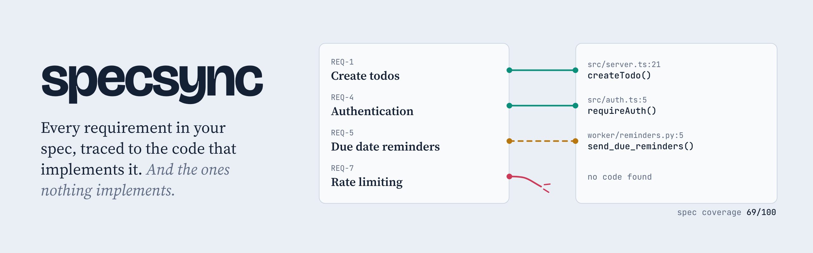
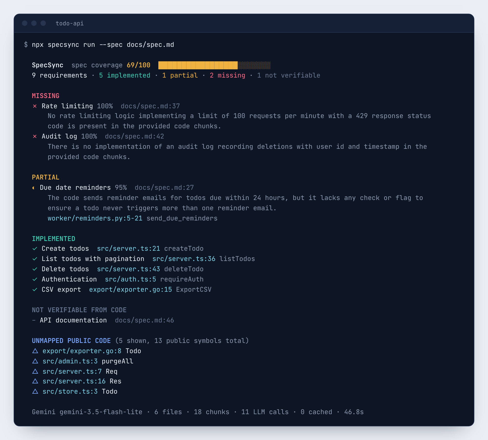
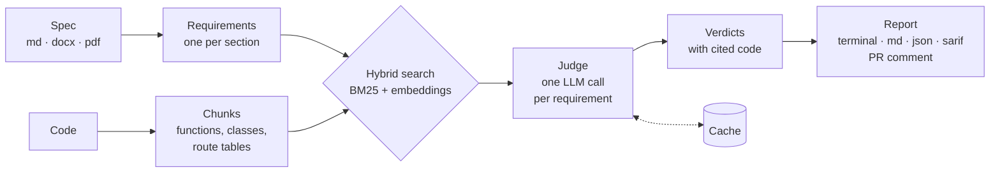

<picture>
  <source media="(prefers-color-scheme: dark)" srcset=".github/assets/banner-dark.png">
  
</picture>

<p>
  <a href="https://github.com/tusiim3/specsync/actions/workflows/ci.yml"></a>
  <a href="LICENSE"></a>
  
  
</p>

**SpecSync reads your spec or PRD, finds the code behind every requirement, and tells you which ones are implemented, which are half done, and which nothing implements.** Run it locally or on every pull request, where it comments what a change broke.

```bash
npx specsync run --spec docs/spec.md --repo src
```



- **Any spec.** Markdown, Word, PDF, HTML or plain text. One requirement per section, or `REQ-12`-style ids if you have them.
- **Any codebase.** Structural parsing for TypeScript, JavaScript, Python, Go, Java, Ruby, Rust, C#, PHP and C/C++; line windows for everything else.
- **Evidence, not vibes.** Every verdict cites the exact functions it was based on. Claims without evidence are downgraded, not trusted.
- **Built for CI.** Exit codes, thresholds, SARIF for code scanning, and a GitHub Action that compares the PR against its base branch.
- **Cheap to re-run.** Embeddings and verdicts are cached by content hash, so an unchanged requirement never costs a second call.
- **Your model.** Gemini (the free tier works), Claude, OpenAI, a local Ollama model, or any OpenAI-compatible endpoint.

---

## Contents

[Quick start](#quick-start) · [Pull requests](#on-every-pull-request) · [How it works](#how-it-works) · [Verdicts and score](#verdicts-and-the-score) · [Accuracy](#accuracy) · [CLI](#cli-reference) · [Configuration](#configuration) · [Providers](#providers-and-privacy) · [Embeddings](#embeddings) · [Compared with](#how-it-compares) · [Limits](#limits) · [Development](#development)

## Quick start

1. Get a key. [Gemini's free tier](https://aistudio.google.com) is enough to start; Claude, OpenAI or a local Ollama work too.

   ```bash
   export GEMINI_API_KEY=...
   ```

2. Create a config in your project (optional, but makes every later command short):

   ```bash
   npx specsync init
   ```

   This writes `specsync.config.json` pointing at your spec and code, and adds `.specsync/` (cache and history) to `.gitignore`.

3. Run it:

   ```bash
   npx specsync run
   ```

You get the report in the terminal. Add `--md report.md`, `--json report.json` or `--sarif specsync.sarif` to also write files. The next run reuses cached verdicts and only re-checks requirements whose text or code changed.

To see what a run would cost before it makes any calls:

```bash
npx specsync run --dry-run
```

> Not published to npm yet? Run from a clone: `npm ci && npm run build && node dist/bin.js run ...`

## On every pull request

```yaml
# .github/workflows/specsync.yml
name: specsync
on: pull_request
permissions:
  contents: read
  pull-requests: write
jobs:
  spec-coverage:
    runs-on: ubuntu-latest
    steps:
      - uses: actions/checkout@v4
      - uses: tusiim3/specsync@v1
        env:
          GEMINI_API_KEY: ${{ secrets.GEMINI_API_KEY }}
        with:
          spec: docs/spec.md
          repo: src
          min-score: 70
          fail-on: error,regression
```

The action analyzes the base commit and the PR head (sharing one cache, so unchanged requirements are judged once), then posts a single comment that it updates on each push:

> **Spec coverage: 63/100** (−6 vs base)
>
> 🔻 **Authentication**: implemented → partial
>
> 🟡 **Authentication** · partial · `docs/spec.md:22`
> Protected endpoints are wrapped with `requireAuth`, but missing or invalid tokens fall back to an anonymous user instead of being rejected with 401.

It also writes the full report to the job summary, and with `sarif: specsync.sarif` plus [`github/codeql-action/upload-sarif`](https://github.com/github/codeql-action) the gaps appear in code scanning, pinned to the line of the spec they come from.

| Input | Default | |
|---|---|---|
| `spec` | from config | Spec file(s), space separated |
| `repo` | from config | Code directory |
| `config` | auto | Path to `specsync.config.json` |
| `provider`, `model` | auto | LLM provider and model; keys come from `env` |
| `embeddings` | `auto` | Where embeddings run; the local model is cached between runs |
| `min-score` | none | Fail below this coverage (0 to 100) |
| `fail-on` | `error,regression` | Any of `missing`, `partial`, `error`, `regression` |
| `compare-base` | `true` | Also analyze the base commit and report the delta |
| `comment` | `true` | Post or update the PR comment |
| `sarif` | none | Path to write SARIF |
| `working-directory` | `.` | Where to run, relative to the repo root |
| `github-token` | `github.token` | Token used to comment |

Outputs: `score`, `exit-code`, `report-json`, `report-markdown`. On pull requests from forks the token is read-only, so the action warns and leaves the report in the job summary instead of commenting.

This repository runs SpecSync on itself: [`docs/spec.md`](docs/spec.md) is SpecSync's own specification, checked against `src/` on every PR.

## How it works



1. **Requirements.** The spec is converted to Markdown (Word heading styles and PDF font sizes become headings) and split into one requirement per section. Explicit ids like `REQ-12` are kept; "Out of scope", "Glossary" and similar sections are skipped.
2. **Chunks.** Source files are parsed with tree-sitter into functions, methods, classes and the code between them (route registrations, config), each with its doc comment and whether it is public.
3. **Search.** Each requirement is matched to code with BM25 keyword search and embedding similarity, fused by rank. A requirement that lists several behaviours is searched once per item, so each behaviour gets a chance to find its code.
4. **Judge.** One structured LLM call per requirement, in parallel, sees the requirement and its candidate code and returns a verdict, a confidence, the chunks it relied on and a short note. Citations of code it was not shown are dropped.
5. **Report.** Scores, evidence links, a diff against the previous run, and the public code no requirement points to.

Cost scales with the number of requirements, not the size of the codebase: one call per requirement, and none at all when nothing relevant changed.

## Verdicts and the score

| Verdict | Meaning |
|---|---|
| ✅ implemented | The shown code does everything the requirement asks, including its limits and error cases |
| 🟡 partial | Some of it is there; the note says what is missing |
| ❌ missing | Nothing in the code does it |
| ⚪ not verifiable | Cannot be judged from code (process, docs, uptime) |
| ⚠️ error | The provider failed after retries; the run is marked incomplete |

**Spec coverage** = (implemented + ½ × partial) ÷ checked requirements × 100, where not-verifiable and errored requirements are not counted. An incomplete run says so in every output and makes `check` exit with code 2, so a provider outage can never pass as a drop in coverage.

**Unmapped public code** lists exported functions and classes that no implemented or partial requirement cites. It's where undocumented behaviour, and specs that fell behind the code, show up.

## Accuracy

`npm run eval` scores SpecSync against hand-labelled requirements ([`eval/cases.json`](eval/cases.json)): a multi-language fixture app and Express 5's `lib/` against an Express spec. Where a careful reviewer could defend more than one verdict, both count.

| Model | Embeddings | Verdict accuracy | Gap precision | Gap recall |
|---|---|---|---|---|
| Gemini 3.5 Flash-Lite (default, free tier) | local `bge-small-en-v1.5` (default) | 17/17 (100%) | 100% | 100% |
| Gemini 3.5 Flash-Lite | Gemini `gemini-embedding-001` | 16/17 (94%) | 100% | 100% |

That is a small set, so treat it as a smoke test rather than a benchmark. Results also vary a little between runs of the same model. Run it with your own provider: `npm run eval -- --model <id>`.

## CLI reference

```text
specsync init                 create specsync.config.json (and add .specsync/ to .gitignore)
specsync run                  analyze and print the report
specsync check                same as run, but exit non-zero when thresholds fail
specsync diff [before after]  compare two JSON reports, or the last two runs in history
```

Options for `run` and `check`:

| Option | |
|---|---|
| `-s, --spec <paths...>` | Spec document(s): `.md`, `.markdown`, `.mdx`, `.txt`, `.docx`, `.pdf`, `.html` |
| `-r, --repo <dir>` | Code directory (default `.`) |
| `-c, --config <file>` | Config file (default `specsync.config.json` if present) |
| `-p, --provider <name>` | `auto`, `gemini`, `anthropic`, `openai`, `ollama`, `openai-compatible` |
| `-m, --model <id>` | Model for the provider |
| `-e, --embeddings <provider>` | `auto` (default), `local`, `gemini`, `openai`, `openai-compatible`; see [Embeddings](#embeddings) |
| `--embeddings-model <id>` | Embedding model for that provider |
| `--concurrency <n>` | Parallel LLM calls (default 4) |
| `--top-k <n>` | Code chunks shown per requirement (default 8; more for list-style requirements) |
| `--extract <mode>` | `headings` (default) or `llm` to split sections into atomic requirements |
| `-f, --format <format>` | Stdout format: `text`, `markdown`, `json`, `sarif` |
| `--md <file>`, `-o, --out <file>` | Write a Markdown report |
| `--json <file>` | Write the JSON report |
| `--sarif <file>` | Write SARIF 2.1.0 |
| `--comment-md <file>` | Write the compact Markdown used for PR comments |
| `--link-base <url>` | Link evidence in Markdown, e.g. `https://github.com/o/r/blob/<sha>/` |
| `--baseline <file>` | Compare against this JSON report (default: previous run in history) |
| `--no-cache` | Ignore and don't write the cache |
| `--cache-dir <dir>` | Cache directory (default `.specsync/cache`) |
| `--no-history` | Don't record the run in `.specsync/history.json` |
| `--dry-run` | Show calls and estimated tokens without calling the model |
| `-q, --quiet` | No progress output |
| `-v, --verbose` | Notes and evidence for every requirement, not just the ones needing attention |
| `--min-score <n>` | `check` only: fail below this coverage |
| `--fail-on <list>` | `check` only: any of `missing`, `partial`, `error`, `regression` |

Exit codes: **0** passed, **1** a threshold failed (or `diff` found regressions), **2** the run could not complete or the input was invalid.

Paths on the command line are relative to where you run it; paths in a config file are relative to the config file.

## Configuration

`specsync.config.json` (or `.specsyncrc.json`). Every field is optional; add `"$schema": "./node_modules/specsync/schema/specsync.schema.json"` for editor autocomplete.

```jsonc
{
  "spec": "docs/spec.md",            // or ["docs/prd.docx", "docs/api.md"]
  "repo": "src",
  "include": ["**/*.ts"],            // default: every supported source file
  "exclude": ["src/generated/**"],   // added to the defaults below
  "excludeTests": true,              // tests don't count as implementations
  "extraction": "headings",          // or "llm"
  "ignoreSections": ["^out of scope$", "^glossary$"],  // regexes; these are part of the defaults
  "provider": {
    "name": "auto",                  // gemini | anthropic | openai | ollama | openai-compatible
    "model": "gemini-3.5-flash-lite",
    "baseUrl": "https://openrouter.ai/api/v1",  // openai-compatible (and overrides)
    "apiKeyEnv": "OPENROUTER_API_KEY",          // which env var holds the key
    "concurrency": 4,
    "timeoutMs": 120000,
    "maxRetries": 6,
    "requestsPerMinute": 15          // pace calls under a quota, e.g. Gemini free tier
  },
  "embeddings": {
    "provider": "auto",              // auto | local | gemini | openai | openai-compatible
    "model": "Xenova/bge-small-en-v1.5"
  },
  "retrieval": { "topK": 8, "maxCandidateTokens": 8000 },
  "thresholds": { "minScore": 70, "failOn": ["error", "regression"] },
  "surplus": { "limit": 25 },
  "budget": { "maxLlmCalls": 200, "maxInputTokens": 2000000 },
  "cacheDir": ".specsync/cache",
  "historyFile": ".specsync/history.json"
}
```

Default exclusions: `node_modules`, `dist`, `build`, `out`, `coverage`, `vendor`, `.git`, `.specsync`, `*.min.js`, `*.d.ts`, and tests (`*.test.*`, `*.spec.*`, `__tests__/`, `test/`, `tests/`). They match relative to `repo`, so a project that itself lives in a folder called `build` still works. `.gitignore` and `.specsyncignore` files are honoured at every level.

Environment variables: `GEMINI_API_KEY`, `ANTHROPIC_API_KEY`, `OPENAI_API_KEY`, `OLLAMA_BASE_URL` / `OLLAMA_MODEL`, `SPECSYNC_MODEL` (model for whichever provider runs), `SPECSYNC_BASE_URL` / `SPECSYNC_API_KEY` (openai-compatible), `SPECSYNC_MODEL_CACHE` (where the local embedding model is stored), `NO_COLOR`, `DEBUG`. A `.env` file in the working directory is read too; see [`.env.example`](.env.example).

## Providers and privacy

| Provider | Key | Default model | Price per 1M tokens (in / out) |
|---|---|---|---|
| Gemini | `GEMINI_API_KEY` | `gemini-3.5-flash-lite` | $0.30 / $2.50, free tier available |
| Anthropic | `ANTHROPIC_API_KEY` | `claude-haiku-5-5` | $0.10 / $0.50 |
| OpenAI | `OPENAI_API_KEY` | `gpt-5.4-mini` | $0.75 / $4.50 |
| Ollama | none (local) | `qwen3:8b` | free, runs on an 8 GB machine |
| OpenAI-compatible | `SPECSYNC_API_KEY` | set `provider.model` | |

`auto` uses the first of these that is configured. Requests use each provider's structured-output mode, so replies are schema-checked JSON.

Defaults are the cheap tier of each provider: a run makes one call per requirement (roughly 2,000 input tokens each) and caches it, so even a 100-requirement spec costs cents. Want more judgement on hard specs? Pick a bigger model with `--model`, for example `gemini-3.5-flash`, `claude-sonnet-5-5` or `gpt-5.4`, and compare with `npm run eval`.

### Embeddings

Embeddings help match a requirement to code that uses different words than the spec. You choose where they run:

| `--embeddings` | What happens | Setup |
|---|---|---|
| `auto` (default) | Uses the local model; if it can't be downloaded (offline, firewall), switches to Gemini or OpenAI embeddings when you have that key | none |
| `local` | [`bge-small-en-v1.5`](https://huggingface.co/Xenova/bge-small-en-v1.5), downloaded once (~35 MB) from Hugging Face and run on your CPU. Code never leaves your machine for this step | none; needs `huggingface.co` reachable the first time |
| `gemini` | `gemini-embedding-001` via the Gemini API | `GEMINI_API_KEY` |
| `openai` | `text-embedding-3-small` | `OPENAI_API_KEY` |
| `openai-compatible` | Any `/embeddings` endpoint | `embeddings.baseUrl` and `embeddings.model` |

You don't need to install anything for `local`: SpecSync downloads the model itself on first use and caches it (set `SPECSYNC_MODEL_CACHE` to choose where). API embeddings on free tiers are rate limited (Gemini allows 100 texts a minute), so a first run on a large repo is slower there; the cache makes every later run fast.

`npm run eval:retrieval` measures how often the right file is among the top results. On the labelled requirements in [`eval/retrieval.json`](eval/retrieval.json) (31 across three codebases), `bge-small-en-v1.5` found a correct file in the top 2 every time with an MRR of 0.98, ahead of `all-MiniLM-L6-v2` (0.95) and the larger `bge-base-en-v1.5` (0.91). Keyword search alone also scored 0.98 there, because those specs mostly reuse the code's own names; embeddings earn their keep when the spec is written in product language.

**What leaves your machine:** each requirement's text and the code chunks retrieved for it are sent to the LLM provider you choose, plus all code chunks to the embedding API if you pick `gemini`, `openai` or `openai-compatible` embeddings. Nothing goes to SpecSync itself. For code that must not leave your network, use Ollama or a self-hosted OpenAI-compatible server with `--embeddings local`.

## How it compares

| | Checks | Scope |
|---|---|---|
| **SpecSync** | Every requirement in a prose spec against the whole codebase, with history and PR deltas | Any repo, any existing spec |
| CodeRabbit linked-issue checks | One PR's diff against the issue it links | Per pull request |
| GitHub Spec Kit, Kiro, Tessl | Generated code against specs written in their workflow | Projects that adopted the workflow |
| oasdiff and API drift tools | An implementation against an OpenAPI contract | Machine-readable API specs |

They work well together: spec-driven tools help you write the code, and SpecSync keeps checking that the spec and the code still agree months later.

## Limits

- Verdicts come from a language model judging retrieved code. They are usually right and always cite their evidence, but check the evidence before acting on a surprising one.
- Retrieval sees only the analyzed folder. Behaviour that lives in a dependency (Express routing in the `router` package, for example) shows as partial or missing.
- Very large requirements are judged as one unit; `--extract llm` splits them into atomic ones.
- PDF heading detection is heuristic (font size and numbering). Tagged Markdown or Word documents give the cleanest results.

## Development

```bash
npm ci
npm test            # vitest, offline: scripted provider and hashed embeddings
npm run lint
npm run typecheck
npm run build
npm run eval        # real provider, labelled verdicts
npm run eval:retrieval -- --embeddings local   # retrieval only, no LLM calls
```

`test/fixtures/todo-api` is a small TypeScript, Python and Go app with a spec and known answers; the golden test runs the whole pipeline on it. `scripts/render-assets.mjs` regenerates the README images from `.github/assets/src`, the terminal image from a real report.

### Releasing

Bump `version` in `package.json` on master, then on GitHub open **Releases → Draft a new release**, create the tag `v<version>` targeting `master`, and publish. The release workflow checks the tag matches `package.json`, runs the checks, publishes to npm (with the `NPM_TOKEN` secret) and moves the major tag (`v1`) so the Action's `@v1` users get the update.

## License

[Apache 2.0](LICENSE).
